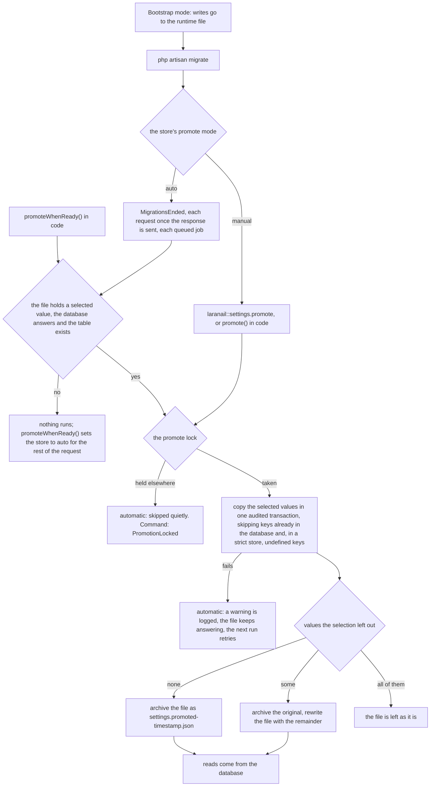

# Moving from files to the database

Start an install on the runtime file, then move what was written into the database once it exists.

## During the install

Opt the store into bootstrap mode and give the evidence that an install is running:

```php
'stores' => [
    'settings' => ['layers' => ['database', 'runtime', 'shipped'], 'bootstrap' => true],
],
```

```dotenv
LARANAIL_SETTINGS_BOOTSTRAP=true
```

`laranail/installer-headless` reporting an install in progress counts as evidence too. While the
evidence holds and the database is not ready, the database layer is skipped: writes go to the
runtime file and a `LayerSkipped` event says so. Encrypted settings still need an `APP_KEY`.

## After migrating

```bash
php artisan migrate
php artisan laranail::settings.promote
```

Promotion copies only what was written to the runtime file; shipped defaults stay in the shipped
file, so a later release can change them. Keys that already have a database row are skipped and
listed (use `--force` to overwrite), and the file is archived as
`settings.promoted-<timestamp>.json`. Running it again does nothing. To replay an archive into a
database restored from an older backup:

```bash
php artisan laranail::settings.promote --from=laranail/settings/settings.promoted-20261109_101500_000000.json
```

## Promoting automatically

Set the store to promote on its own, and it copies the runtime file into the database once, the
first time the database connection answers and the store's table exists:

```php
'stores' => [
    'settings' => ['layers' => ['database', 'runtime', 'shipped'], 'bootstrap' => true, 'promote' => 'auto'],
],
```

`LARANAIL_SETTINGS_PROMOTE=auto` does the same for every store.

## Configure promotion

Every promotion option can be set in the configuration file, in code, or both:

```php
// config/laranail/settings.php
'stores' => [
    'settings' => [
        'promote' => [
            'mode'    => 'auto',          // manual | auto
            'include' => ['owners'],      // settings, owners, or ['*'] (the default)
            'owners'  => ['user'],        // null (the default) for every owner
        ],
    ],
],
```

```php
// in code, for the current request or job
Settings::store('settings')->promotion()
    ->auto()                          // ->manual()
    ->only('owners')                  // ->everything()
    ->forOwners('user');              // ->forAllOwners()
```

**Precedence, highest first: the fluent setters, then the runtime configuration
(`configuration()->addStore()`), then persisted configuration, then the configuration file**
(the last three in `configuration.sources` order, which is that order by default).
`LARANAIL_SETTINGS_PROMOTE` overrides every store's configured `mode`; only the fluent setters
beat it. Each option is resolved on its own, so `->only('owners')` changes what is copied and
leaves the mode to configuration. The string `'promote' => 'auto'` is shorthand for everything.
Automatic promotion, `promoteWhenReady()`, the command's defaults and `doctor` all read the same
resolved options.

The runtime file holds setting values only: `settings` are the application-wide values and
`owners` the per-owner ones. Categories and definitions never go to the file, so they cannot be
promoted from it, and naming them is an error.

The archive keeps the whole original file. What the selection leaves out is written back to the
runtime file in one rename, so it keeps answering reads from there, and it is never promoted on
its own. The command takes the same choice: `--only=settings,owners` and `--owner=user,team`. The promotion runs straight after
`php artisan migrate`, and otherwise after the first request or queued job that finds the database
ready, once the response has been sent. Until then each request costs one file check; once the
file is archived there is nothing left to check against the database. While a selective
promotion leaves values in the file, each request also reads the file to see that none of them is
selected, and still runs no query. It runs as the system, takes
the same lock as the command (a held lock means another process is already promoting), skips keys
that already have a database row, and is audited and logged like a manual promotion. When it
fails, the failure is logged as a warning, the file keeps answering reads, and the next request
tries again.

An installer that cannot know whether the database is ready yet can ask for the same thing in
code:

```php
Settings::store('settings')->asSystem('installer')->promoteWhenReady();
```

It promotes at once when it can, and otherwise sets the store to `auto` for the rest of the
request, job or command.

## The lifecycle

Manual and automatic promotion are the same action, `Actions\PromoteStore`; they differ in what
starts it and in how a held lock is reported.



## Leaving bootstrap mode

Once the values are in the database, remove `LARANAIL_SETTINGS_BOOTSTRAP`. From then on an unreachable database raises
`DriverUnavailable`; it never falls back to the file.

---

[← Docs index](../../README.md#documentation)
