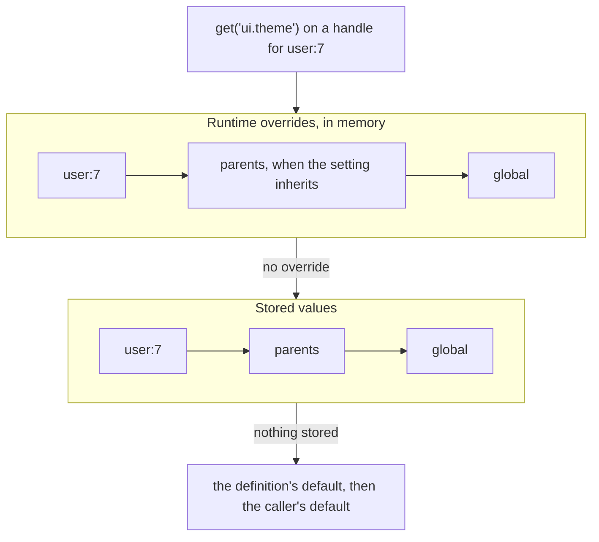

# Runtime overrides

Five methods on the `Settings` handle (`Simtabi\Laranail\Settings\Contracts\Settings`) hold a setting's value in memory for the current request or job, ahead of every stored layer.

An override changes what a read returns, here, for now, and nothing else. It is not a write: nothing reaches the database, the runtime file, the cache, the audit trail or the history, no event fires, and no other request or job sees it. It is not [runtime configuration](runtime-configuration.md) either: `configuration()` changes how settings are stored and governed (stores, layers, drivers, definitions, access), while an override changes one setting's value and leaves the configuration alone. And it is not the [test fake](../recipes/testing-with-the-fake.md): the fake swaps the whole engine for in-memory layers and records writes for assertions, while an override sits on top of whichever engine is bound, real or fake.

## When to use which

| You want to | Use | Durable | Audited | Seen by other requests |
|---|---|---|---|---|
| Change a value for everyone, from now on | [`set()`](settings-api.md#set) | yes | yes | yes |
| Change a value for this request, job or block of code only | `override()` / `withOverrides()` | no | no | no |
| Change stores, layers, definitions or who may do what, for this request | [`configuration()`](runtime-configuration.md) / `withConfiguration()` | no | the change is logged | no |
| Test code that reads and writes settings, and assert on its writes | [`Settings::fake()`](../recipes/testing-with-the-fake.md) | no (in memory) | to the fake's log | no |
| Give one owner a value of its own, kept | [`for($owner)->set()`](owners.md) | yes | yes | yes |

Typical overrides: a preview of unsaved changes, an import or backfill that must not send mail, a support session that sees a feature turned on, a queued job that runs one tenant's work with a different limit, and a test that needs one value different without faking the engine.

## Methods

Every method runs on any handle, so `store()`, `for()` and `locale()` choose where the override is held, exactly as they choose where `set()` writes. None of them needs an ability, and none is reachable over the REST API.

### `override()`

```php
public function override(string|array $key, mixed $value = null): void
```

```php
use Simtabi\Laranail\Settings\Contracts\Settings;

public function handle(Settings $settings): void
{
    // One key, global: every owner reads it, unless the owner has an override of its own.
    $settings->override('mail.default', 'log');

    // Several keys at once.
    $settings->override([
        'features.beta' => true,
        'limits.seats'  => 50,
    ]);

    // One owner, one locale.
    $settings->for($user)->locale('fr')->override('site.tagline', 'Bienvenue');
}
```

Returns nothing. The value goes through the same validation and casting as a write (the definition's `rules`, its type's caster and `laranail.settings.values.max_bytes`), so a later `integer()` or `boolean()` returns the definition's type. A second `override()` of the same key, owner and locale replaces the first. `null` is a value: a read answers `null` and `has()` is true.

| Throws | When |
|---|---|
| `InvalidKey` | a key is not a valid setting key, or the array has an entry without a key |
| `InvalidSettingValue` | a value fails the definition's rules or caster, or encodes to more than `values.max_bytes` |
| `UnknownSetting` | the store is strict and has no definition for the key |
| `OwnerNotAllowed` | the handle names a store that does not accept its owner |

With an array, keys are applied in order and the first refusal stops the rest; earlier keys stay overridden.

### `forgetOverride()`

```php
public function forgetOverride(string $key): void
```

```php
$settings->for($user)->forgetOverride('ui.theme');

$settings->for($user)->get('ui.theme');   // the stored value again, or a parent or global override
```

Returns nothing. Drops this handle's own override of the key (its store, owner and locale) and nothing else: an override held at a parent or the global scope still answers. Forgetting a key that has no override does nothing. Throws `InvalidKey`, `UnknownSetting` and `OwnerNotAllowed` as `override()` does.

### `hasOverride()`

```php
public function hasOverride(string $key): bool
```

```php
if ($settings->for($user)->hasOverride('ui.theme')) {
    // this user holds their own override of ui.theme
}
```

Whether this handle holds its own override of the key. It does not walk to parents or the global scope; to know whether a read **is answered** by an override, ask the read itself:

```php
$settings->for($user)->lookup('ui.theme')->layer() === 'override';
```

Throws `InvalidKey`, `UnknownSetting` and `OwnerNotAllowed` as `override()` does.

### `clearOverrides()`

```php
public function clearOverrides(): void
```

```php
$settings->clearOverrides();
```

Returns nothing. Drops every override held for the current request or job, whichever handle set it: every store, owner, locale and tenant. Use it at the end of a long-running loop that set overrides as it went; a request or job does not need it, because its overrides end with it.

### `withOverrides()`

```php
public function withOverrides(array $values, callable $run): mixed
```

```php
$html = $settings->withOverrides(
    ['site.name' => $draft->name, 'ui.theme' => $draft->theme],
    fn (): string => view('home')->render(),
);
```

Overrides `$values` (on this handle's store, owner and locale, as `override()` would), runs `$run`, and returns what it returns. Afterwards every override is put back exactly as it was before the call, in a `finally`, so this also holds when `$run` throws: overrides the callback set itself are dropped, and overrides that existed before come back. Calls nest, each restoring the state around it:

```php
$settings->withOverrides(['site.name' => 'Outer'], function () use ($settings): void {
    $settings->withOverrides(['site.name' => 'Inner'], function () use ($settings): void {
        $settings->get('site.name');   // 'Inner'
    });

    $settings->get('site.name');       // 'Outer'
});

$settings->get('site.name');           // the stored value
```

Throws what `override()` throws, before `$run` runs (and then nothing is overridden), and whatever `$run` throws, after restoring.

## Precedence

An override answers before any store is read. The resolver walks the same scopes and locales for overrides as it does for stored values, and the first override it finds wins; only when no override applies does it read the layers.



Three consequences worth knowing:

- **A global override beats a stored owner value.** `$settings->override('ui.theme', 'dark')` makes every user read `dark`, including a user who saved `light`, unless that user has an override of their own. This is what "override" means here: it sits above the database, not beside the global row.
- **Inheritance is the definition's.** An owner reaches parent and global overrides only when the setting inherits (its definition's `inherits()`, or else the store's `inherits`), exactly as it reaches parent and global stored values. A setting that does not inherit sees only the owner's own override.
- **Precedence and locks do not apply.** A definition's `precedence` (`file` or `config`) chooses between stored layers, and a lock stops writes; an override is neither, so it answers for a locked setting and for one whose shipped file normally wins. That is deliberate: the override is a code-level decision made by the application for this request, and it changes nothing anyone else can see. If a value must never differ, do not override it.

## Scoping and lifetime

Overrides live in one object, `Services\Resolution\Overrides`, bound `scoped`. Every handle of the request shares it, so an override set through the facade is seen by a `Settings` injected elsewhere, and by the [typed settings](typed-settings.md) classes.

- **HTTP request.** An override lasts until the response is sent.
- **Queued job.** The queue worker flushes scoped instances before each job, so an override set in one job is never seen by the next, even on a long-running worker. A job does not inherit the overrides of the request that dispatched it; set them inside the job. With the `sync` driver the job runs inside the dispatching request, so it does see that request's overrides.
- **Octane.** Octane flushes scoped instances between requests, so nothing leaks from one request into the next on the same worker.
- **A command or a long-running loop.** One process is one lifecycle: an override lasts until the command ends. Use `withOverrides()` around each unit of work, or `clearOverrides()` after it.
- **Tenancy.** Overrides are held per tenant, as preloaded rows are: an override set while one tenant is current does not answer while another is.

`withOverrides()` is the safe form whenever the override belongs to a block of code rather than to the whole request: it cannot outlive the block, even when the block throws.

## Owners and locales

An override is keyed exactly like a stored value: store, owner scope, key and locale.

```php
$settings->override('ui.theme', 'dark');                         // global, default store
$settings->for($team)->override('ui.theme', 'blue');             // team:3, its members inherit it when ui.theme inherits
$settings->for($user)->override('ui.theme', 'high-contrast');    // user:7 only
$settings->store('product_settings')->for($product)->override('pricing.currency', 'EUR');
```

The store is chosen as for a write: the named store, else the store that accepts the owner's alias, else the default store. A global override on a dedicated store is held where that store's reads look for global values, its fallback store.

Locales follow the read's fallback: a read in `de` tries the `de` override, then the `app.fallback_locale` override, then the unlocalised one. A key whose definition is not `localised()` holds one override whatever locale the handle has, as it holds one stored value.

```php
$settings->locale('en')->override('site.tagline', 'Welcome');
$settings->locale('de')->get('site.tagline');   // 'Welcome', through the fallback locale
```

## Typed settings and casting

Because an override is validated and cast like a write, the typed getters and typed settings classes see the definition's type:

```php
$settings->override('limits.seats', '50');   // an `int` definition casts the numeric string
$settings->integer('limits.seats');          // 50

$mail = MailSettings::load($settings);       // properties read overrides like any other value
```

`load()` reads overrides. `save()` never persists them: a property answered by an override and left unchanged is skipped, also when `save($settings)` is given a handle and would otherwise write every property. A property you change after loading is a real change, and `save()` writes it.

## How overrides meet the rest of the package

| Feature | With an override |
|---|---|
| **Cache** | Not involved. An override answers before the database layer is asked, so the cache is neither read nor filled for that key, and an override hit runs no query. Forgetting the override returns the cached or stored value unchanged. |
| **Locks** | Ignored: an override is not a write. A lock still stops `set()` and `forget()`. |
| **Encryption** | Not applied. An override is never at rest, so it is held as the plain value; it is never written, logged or put in an exception message. |
| **Sensitive values** | Reads are guarded as before: a sensitive key still needs `view_sensitive` for an actor, and `explain()` redacts it. |
| **Approvals** | Not involved: an override is not a change request and needs no approval. |
| **History and audit** | Nothing is recorded. There is no version, no history row and no audit entry. |
| **Events** | None fires: no `SettingSaving`, `SettingSaved` or any other event. |
| **`explain()`** | The answer's layer is `override` and its scope is where the override was found; each override tried is a step ending in `/ override`. With no override held, the steps are exactly as before. |
| **`laranail::settings.show`** | Shows `Layer: override` and an `Override` row, when the command runs in the process that set it (for example in a test, or from code calling `Artisan::call()`). A separate `php artisan` run starts a new process with no overrides. |
| **`all()`** | Lists overridden keys of the handle's store and scope beside the stored and defined ones. |
| **The fake** | `Settings::fake()` supports every method, and an override is never recorded as saved, so `assertNotSaved()` still passes. |

## Security

- **Code only.** Overriding is a call your application makes. It needs no ability, because it changes nothing durable and nothing another request sees; it is not a way for a user to change a setting.
- **Not on the REST API.** No route sets, lists or clears overrides, and none will: a value held for one HTTP request would vanish before a client could read it back, and exposing it would let a client change what server-side code reads in the same request. A test asserts that no route and no controller reaches these methods.
- **Reads stay guarded.** An override does not widen what an actor may read: `view` and `view_sensitive` apply as for a stored value.
- **Do not override from user input without checking it.** `override($request->input('key'), …)` would let a request change any setting your code reads in that request. Name the keys in code.

## Troubleshooting

| Symptom | Cause | Fix |
|---|---|---|
| An owner does not see a global override | the setting does not inherit | define it with `inherits()`, or override on the owner's handle |
| A locale does not see an override | the override was set for another locale, and neither the fallback nor the unlocalised one is set | override without a locale, or in `app.fallback_locale` |
| `hasOverride()` is false but `get()` returns the override | `hasOverride()` asks about this handle's own override; the answer came from a parent or the global scope | check `lookup($key)->layer() === 'override'` |
| The override is gone in a queued job | each job starts with no overrides | set it inside the job (see the [recipe](../recipes/overriding-a-setting-for-one-request.md)) |
| A long-running command keeps an old override | one process is one lifecycle | wrap each unit of work in `withOverrides()`, or call `clearOverrides()` |
| `show` does not mark the override | `php artisan` runs in a new process, with no overrides | call the command from the code that set the override, or use `explain()` |
| `override()` throws `InvalidSettingValue` | the value fails the definition's rules or type, or is over `values.max_bytes` | pass a value a `set()` would accept |
| `override()` throws `UnknownSetting` | the store is strict and the key is not defined | define the key first |

---

[← Docs index](../../README.md#documentation)
